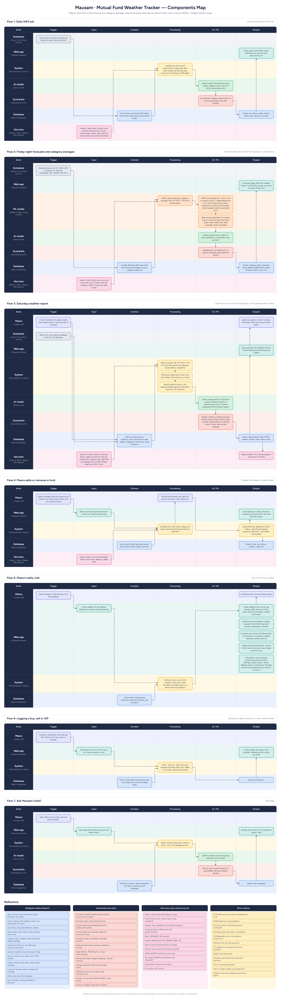

# Architecture

The component map is a swimlane diagram: columns are Trigger → Input → Context → Processing → AI / ML → Output; rows are the actors (Meera, Scheduler, Web app, System, ML model, AI model, Guardrails, Database, Services). The code below follows it flow by flow.

## Layers

| Layer | What | Where |
|---|---|---|
| Web app | Server-rendered Jinja2 pages, hand-written CSS, vanilla JS, Chart.js 4.4.1, Lucide icons | `app/templates`, `public/static` (served by the CDN) |
| System | Flask app as one Vercel Python function (zero-config entrypoint `index.py`) | `app/__init__.py`, `app/routes/*` |
| Services | Pure-Python maths and API clients (no pandas on Vercel) | `app/services/*` |
| Jobs | Daily NAV + Saturday report, logged in `job_runs` | `app/jobs.py`, `app/routes/cron.py` |
| ML | Hybrid ARIMA + Ridge, backtests, category averages — GitHub Actions only | `ml/*`, `.github/workflows/ml_forecast.yml` |
| AI | Gemini Flash via REST, JSON mode + schema | `app/services/gemini.py` |
| Guardrails | Code checks on every AI output | `app/services/guardrails.py` |
| Database | Neon PostgreSQL (pooled), schema in plain SQL | `db/schema.sql`, `app/db.py` |

## The seven flows

**Flow 1 — Daily NAV job** (Vercel Cron `0 18 * * *` ≈ 23:30 IST → `GET /api/cron/daily` with `Bearer CRON_SECRET` → `jobs.daily_nav()`)
1. Load active funds, last stored NAV dates, benchmark tickers and proxies (Neon).
2. `mfapi.top_up()` per scheme (gap-filled); `amfi` NAVAll.txt fills in where mfapi failed or is behind; `indices.refresh("5d")` from Yahoo.
3. Upsert `nav_history` / `index_history`; `alerts.daily_checks()` flags stale data (>4 days) and big moves (>3% equity, >0.5% debt).
4. Gemini writes "One thing to know today" (`assistant.daily_tip`) → guardrails (numbers, no advice, short) → fallback glossary tip.
5. Saved: `nav_history`, `index_history`, `alerts`, `daily_tips`, `news_items`, `job_runs` → Today page.

**Flow 2 — Friday night forecasts and category averages** (GitHub Actions `30 19 * * 5` ≈ 01:00 IST Sat, or manual)
`ml/backfill.py` → `ml/peers.py` (`category.refresh_all_groups`) → `ml/forecast.py` (ARIMA on log NAV with d=1 + drift, Ridge direct 7/30-day models, hybrid weight and interval multiplier from a 12-origin walk-forward backtest, `ml/backtest.py`) → Gemini 2-sentence explanation → guardrails ("estimate, not a promise", no advice) → `category_stats`, `forecasts`, `forecast_metrics`, `job_runs` → Forecasts page. Forecasts never feed the verdict.

**Flow 3 — Saturday weather report** (Vercel Cron `0 2 * * 6` ≈ 07:30 IST, or "Generate now" → `jobs.weekly_report()`)
1. Re-fetch Friday NAVs; build `weekly_snapshots` (`services/snapshots.py`: returns engine, benchmark and category returns, gaps, attribution, holdings, flags).
2. Index moves (`report.index_moves`), news (`news.gather`: GNews → RSS).
3. `verdict.decide()` — rules only: lagging streaks, big monthly gaps, allocation drift → one of three verdicts.
4. `report.build_facts()` → Gemini market summary + report (`report.generate`) → `guardrails.validate_report` (schema, 3 sentences per fund, verdict equals code's, every number matches facts ±0.05, banned phrases) → 1 retry → deterministic fallback template.
5. Saved: `reports`, `market_context`, `news_items`, `alerts`; Resend email; Today hero, Weekly reports, Trends, Market pulse.

**Flow 4 — Add or remove a fund** (Manage funds page)
`GET /api/funds/search` / `GET /api/funds/preview/<code>` (mfapi meta + `benchmarks.classify`) → Meera confirms → `POST /api/funds` (`funds.add`: insert, backfill full NAV history, find peers, rebuild 26 weeks of snapshots). `DELETE /api/funds/<id>` is a soft delete; history is kept.

**Flow 5 — Daily visit** (any page): `routes/pages.py` reads NAVs, transactions, snapshots, reports, forecasts, tips and alerts; `portfolio.summary()` does units, FIFO cost, value, gain, XIRR, allocation and drift.

**Flow 6 — Logging a buy, sell or SIP** (Transactions page): `POST /api/transactions` (`prepare()`: NAV on that date or next business day, units = amount ÷ NAV, sell ≤ units held, simulator flag). Mausam records only; the banner links to MF Central for real money.

**Flow 7 — Ask Mausam** (`POST /api/chat` → `assistant.ask`): context = portfolio summary, latest snapshots and report, glossary, last 6 messages (no name/email) → rate limit 20/hour → Gemini → `guardrails.validate_chat` (no advice, no guarantees, numbers from context) → `chat_messages`.

## Database

| Table | Written by | Read by |
|---|---|---|
| users, settings | seed, Settings | everything |
| benchmarks | `db/seed.sql` | indices, snapshots |
| funds | Manage funds, seed | everything |
| nav_history (`source` = mfapi \| amfi) | daily job, backfill, peers | returns, portfolio, ML |
| index_history | daily job, backfill | benchmark series |
| category_peers, category_stats | peers job, fund add | snapshots, fund page |
| transactions | Transactions page, seed | portfolio |
| weekly_snapshots | weekly job, fund add, seed | verdict, Trends, fund page |
| market_context, news_items | weekly/daily jobs | reports, Market pulse |
| reports | weekly job | Today, Reports, chat |
| forecasts, forecast_metrics | ML workflow | Forecasts, fund page, report appendix |
| alerts, daily_tips, chat_messages | jobs, chat | Today, Alerts, Ask |
| job_runs | every job | System status, manual rate limits |

## Dependency split

- `requirements.txt` (Vercel): flask, psycopg[binary], httpx, certifi, feedparser, python-dateutil, markdown. All maths is pure Python.
- `ml/requirements.txt` (Actions): pandas, numpy, statsmodels, scikit-learn + the light libs above.
